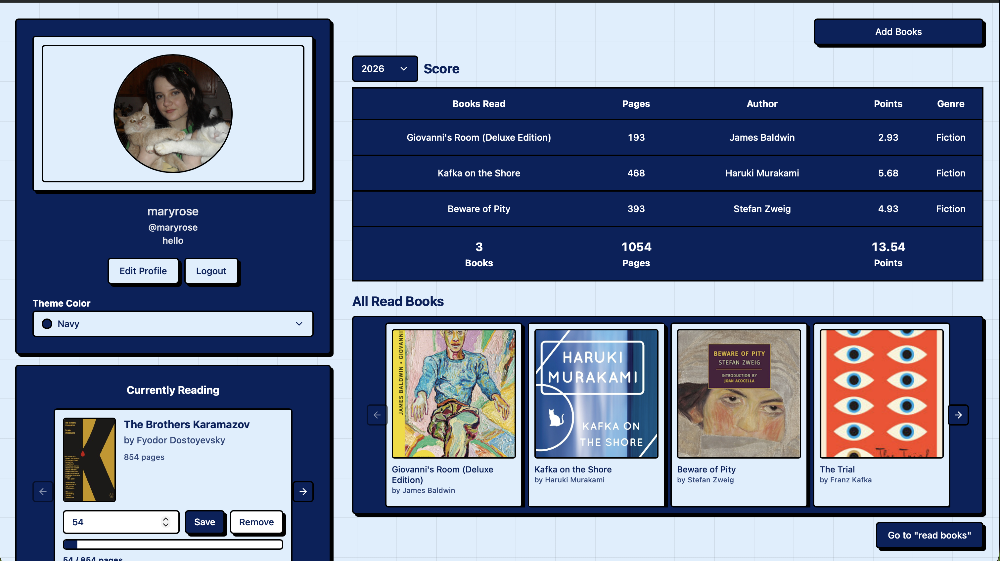

# Reading Tracker

A full-stack social reading tracker for organizing books, tracking yearly reading activity, and comparing progress with friends. Built with a React/TypeScript frontend and an Express/MongoDB backend.

**[Open the live application →](https://reading-website-nine.vercel.app)**

## Live Demo

Select **View Recruiter Demo** on the login page to explore a populated temporary account **without Google authentication**. No account setup is required.

1. Review yearly reading totals and current reading progress on the dashboard.
2. Open a reading shelf, edit a book, or add an edition through search or manual entry.
3. Explore the seeded friend's profile, shelves, and reading comparison.

The API runs on Render's free tier. The initial demo login after inactivity may take about a minute while the backend wakes up.

## Technical Highlights

- **Full-stack application:** React and TypeScript handle the client; an Express API in JavaScript persists users, books, and friendships in MongoDB through Mongoose.
- **Authentication:** Google OAuth sign-in verifies Google ID tokens on the server, then issues JWTs in HTTP-only cookies. Frontend session checks protect app routes, and API middleware verifies authenticated book and friend operations.
- **Book discovery and fallback:** The API combines and deduplicates multiple Google Books searches, retaining results when an individual query fails. The frontend groups editions and supports manual entry when results are incomplete or search is unavailable.
- **Reading and social workflows:** Read, Currently Reading, and Want To Read shelves track completion dates and page progress. Yearly summaries total books, pages, and page-based points. Friend requests, friend shelves, and comparison views support shared reading goals.
- **Temporary demo sessions:** Each session seeds separate reader and friend profiles with books. Visitors can edit books; friendship changes are disabled. Logout deletes the session's profiles and books. Starting a new demo also cleans up demo records older than 24 hours.
- **Automated verification:** Frontend component and utility tests and backend route tests run through a root verification command. GitHub Actions checks lint, tests, the frontend build, and backend JavaScript syntax on pushes and pull requests.

## Screenshots

**Dashboard: profile, yearly totals, and current reading progress**



| Reading shelf | Friend comparison |
| --- | --- |
|  |  |

More screenshots, including login, friends, and the want-to-read shelf, are in [docs/screenshots](docs/screenshots).

## Tech Stack

| Area | Technologies |
| --- | --- |
| Frontend | React 19, TypeScript, Vite, React Router, Tailwind CSS, Radix UI, Axios |
| Backend | Node.js, Express 5, MongoDB, Mongoose, Google Auth Library, JSON Web Tokens |
| Testing and tooling | Vitest, React Testing Library, Supertest, ESLint, GitHub Actions |
| Hosting | Vercel frontend, Render API |

## Architecture

The repository contains three separate npm projects: root orchestration scripts and two applications.

```text
apps/web/src/
  app/          Application composition and route pages
  features/     auth, books, friends, and dashboard modules
  components/   Shared UI and loading/error states
  config/       Browser environment configuration
  lib/          API client and shared helpers
  utils/        Shared utilities
apps/api/
  routes/       Express route modules
  middleware/   Authentication and demo write restrictions
  models/       Mongoose User and Book schemas
  services/     Demo seeding and cleanup
  config/       Server environment configuration
```

Frontend features keep domain-specific API calls, components, hooks, types, and utilities together where needed. Routes compose these modules. The shared Axios client sends cookie credentials; data-heavy pages provide loading placeholders and retryable errors.

The API is organized by domain:

| Route prefix | Responsibilities |
| --- | --- |
| `/api/auth` | Google and demo login, session lookup, profile/theme updates, logout |
| `/api/books` | Public Google Books search; authenticated saved-book reads and writes |
| `/api/friends` | User search, requests, friend lists, and friend data for comparison |

Book queries are scoped to the signed-in user. A compound unique index on user ID and book ID prevents duplicate saved editions per user. Friend shelf access checks the friendship before returning books.

## Local Setup

Use **Node.js 22.12 or newer within Node 22** and npm, plus a local or hosted MongoDB database. From the repository root:

```bash
npm ci
npm ci --prefix apps/web
npm ci --prefix apps/api
cp apps/web/.env.example apps/web/.env
cp apps/api/.env.example apps/api/.env
```

Set `MONGO_URI` and `JWT_SECRET` in the API environment file. For Google sign-in, set matching `GOOGLE_CLIENT_ID` and `VITE_GOOGLE_CLIENT_ID` values in the API and frontend files. `GOOGLE_BOOKS_API_KEY` is optional; demo login bypasses Google authentication but still needs MongoDB and a JWT secret.

```bash
npm run dev
```

Open [localhost:5173](http://localhost:5173). The API defaults to port 4000. See [development setup](docs/development.md#environment-configuration) for environment variables, individual service commands, and troubleshooting.

## Testing and CI

Run from the repository root:

```bash
npm test         # Frontend and API tests
npm run build    # TypeScript check and Vite production build
npm run check    # Lint, tests, build, and backend syntax checks
```

Tests cover shelf transitions and sorting, book components, API URL selection, authenticated routes, demo login/logout, partial search failures, and friend search input validation. API tests mock database models and external calls, so verification needs no running database, API server, or environment files. It does not exercise deployed services or real database integration.

The [CI workflow](.github/workflows/ci.yml) uses Node.js 22 and runs `npm run check` after installing all three projects from their lockfiles.

## Additional Documentation

- [Development](docs/development.md): environment configuration, scripts, dependency and lockfile maintenance, and CI troubleshooting.
- [Deployment](docs/deployment.md): Vercel/Render configuration, production API routing, authentication cookies, and preview requirements.
